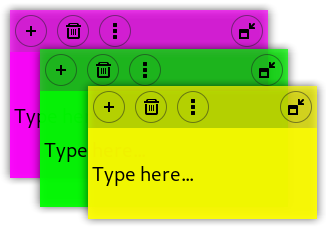

# Notes — GNOME Shell extension

Sticky notes for GNOME Shell with editable Markdown files and a built-in preview.



This fork targets **GNOME Shell 50 and 51**. It uses modern GNOME Shell ECMAScript
modules and GTK4/libadwaita preferences. GNOME 44 and older are **not** supported
by this branch; the older release is available in the Git history.

## Install / update

Requires GNOME Shell 50 or 51, `glib-compile-schemas` and either `curl` or `git`.
Fedora usually ships the required GLib tooling already.

Run the installer directly from a checkout:

```bash
git clone https://github.com/zonaro/notes-extension-gnome.git
cd notes-extension-gnome
./install.sh
```

Or download the installer first and ask it to fetch the latest source from the
repository (review the script before running it):

```bash
curl -fLsS https://raw.githubusercontent.com/zonaro/notes-extension-gnome/master/install.sh -o install-notes.sh
bash install-notes.sh --github
```

The installer targets the current user (no `sudo`), compiles GSettings schemas,
and backs up any previous installation of the **new UUID** under
`~/.local/share/gnome-notes-extension-backups/`.
It does not migrate files from the old extension.

**Log out and log back in** to load the new extension under Wayland. Then run:

```bash
gnome-extensions enable notes@redclaw.com.br
gnome-extensions prefs notes@redclaw.com.br
```

If enabling fails, check the GNOME Shell logs:

```bash
journalctl --user -b | grep -i 'notes@redclaw.com.br'
```

## Markdown and note storage

Each note is a normal UTF-8 Markdown file in **`~/notes/`**:

- `0.md`, `1.md`, etc.: Markdown body and YAML frontmatter for the note's position,
  size, color, font size and visibility. **No `.state` files are created or read.**

Example:

```markdown
---
gnome-notes-x: 40
gnome-notes-y: 80
gnome-notes-width: 250
gnome-notes-height: 180
gnome-notes-color: "255,255,50"
gnome-notes-font-size: 16
gnome-notes-body-visible: true
---
# My note
**Markdown** content here.
```

Edit notes normally, or click the preview button (page icon) on a note to switch
between raw Markdown and a formatted preview. The preview supports headings,
paragraphs, lists, blockquotes, horizontal rules, code blocks, inline code,
**bold**, *italic*, ~~strikethrough~~ and visible link text. Links in the
preview are display-only, not clickable. Markdown files themselves remain
plain text and can be edited with your favorite editor.

There is deliberately **no migration from old Notes versions**. The extension
does not inspect, convert or remove legacy `.state` or `_text` files. Back up
`~/notes/` periodically if you keep important information there.

The extension's UUID is now **`notes@redclaw.com.br`**. Its installation lives
under `~/.local/share/gnome-shell/extensions/notes@redclaw.com.br/`, but the
user's Markdown files stay in `~/notes/`. If the older extension is still
installed, disable `notes@maestroschan.fr` separately in the Extensions app.

## Other features

- Toggle notes from the top panel or a configurable keyboard shortcut.
- Create/delete notes, resize and move notes, adjust colors and font size.
- Choose foreground, background, or a three-state cycle.
- GTK4/libadwaita preferences, including a button to open `~/notes/`.
- Languages shipped: English, Spanish, French, Croatian, Dutch, Brazilian
  Portuguese, Turkish, and Chinese (new strings may initially appear in English).

## Build a ZIP

```bash
./build-a-zip.sh
```

The current archive is named `notes@redclaw.com.br.zip`; old ZIPs with the
previous UUID should not be installed.

## Validation

Syntax and packaging can be checked without a running Shell; full integration
must be checked on GNOME 50 and GNOME 51, including note rendering, focus,
background mode, keyboard shortcut, and frontmatter persistence.

## License and upstream

GPL-3.0. Original extension by [Romain F. T.](https://github.com/maoschanz/notes-extension-gnome).
